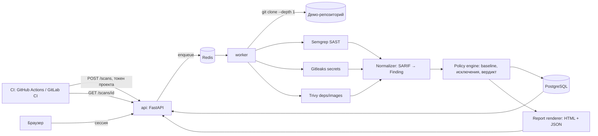

# План: Security Gate — V1

Спека: [spec.md](spec.md). Все решения ниже относятся к MVP из спеки и не расширяют её скоуп.

## Границы

**Входит:** сервис проверок, три сканера, нормализация SARIF, baseline, исключения, политика и вердикт, история, отчёты, простой веб-интерфейс, шаблоны для GitHub Actions и GitLab CI, метрики для экономической части.

**Не входит:** собственные правила анализа, DAST, автофиксы, мультитенантность, SSO, уведомления, экспорт в Prometheus — всё это в разделе «Отложено» спеки.

## Команды

- Установка зависимостей: `uv sync`
- Сборка образов: `docker compose build`
- Запуск стека: `docker compose up -d`
- Остановка: `docker compose down`
- Миграции: `uv run alembic upgrade head`
- Тесты (быстрые): `uv run pytest -m "not integration"`
- Тесты (интеграционные, с БД): `uv run pytest -m integration`
- Линт: `uv run ruff check .`
- Формат: `uv run ruff format .`
- Типы: `uv run mypy app`
- Демо-прогон вручную: `uv run python -m app.cli scan --project demo`

## Архитектура

Один сервис, две роли процесса: `api` и `worker`. Логика проверки не зависит от того, кто её вызвал — GitHub Actions, GitLab CI или curl.

**Компоненты и ответственность**

- `api` — REST, веб-интерфейс, аутентификация, постановка задачи в очередь, отдача отчётов.
- `worker` — приём задачи, клонирование репозитория, запуск сканеров, нормализация, вердикт, запись результатов.
- `scanners/*` — по одному адаптеру на инструмент: команда запуска, таймаут, путь к SARIF, версия.
- `normalizer` — единая модель находки, fingerprint, дедупликация.
- `policy` — чистые функции: сравнение с baseline, применение исключений, вердикт по порогам.
- `reports` — Jinja2-шаблоны HTML и JSON-схема.
- `ci/` — композитный action для GitHub и шаблон для GitLab. Обе обёртки делают три вызова: старт, поллинг, выход с кодом.

**Поток одного прогона**

1. CI вызывает `POST /api/v1/scans` с токеном проекта, `commit_sha`, `ref` и именем провайдера.
2. API проверяет токен, создаёт запись `scans` со статусом `queued`, ставит задачу, отвечает `202` и `scan_id`.
3. Worker клонирует репозиторий в изолированный каталог, запускает три сканера параллельно с общим таймаутом.
4. Каждый сканер пишет SARIF. Нормализатор приводит всё к одной модели, считает fingerprint, убирает дубли внутри прогона.
5. Policy engine: применяет baseline, исключения, размечает `new`/`existing`/`fixed`, считает вердикт.
6. Результаты и метрики пишутся в БД, рендерятся отчёты, статус меняется на `done`.
7. CI поллит `GET /api/v1/scans/{id}`, получает вердикт, завершает job с кодом 0 или 1.

## Данные и контракты

**Схема БД** (PostgreSQL 16, UUID первичные ключи, Alembic-миграции):

| Таблица | Поля (сокращённо) | Зачем |
| --- | --- | --- |
| `users` | id, email, password_hash, role, created_at | вход в интерфейс |
| `sessions` | token_hash, user_id, expires_at | сессия браузера |
| `projects` | id, name, slug, repo_url, default_branch | объект проверки |
| `project_tokens` | id, project_id, name, token_hash, last_used_at, revoked_at | доступ из CI |
| `policies` | project_id, block_severities[], fail_mode, scanner_timeout_sec | правила вердикта |
| `scans` | id, project_id, commit_sha, ref, provider, status, verdict, timings, error | прогон |
| `scanner_runs` | id, scan_id, scanner, status, error, tool_version, duration_ms | состояние каждого сканера |
| `findings` | id, scan_id, fingerprint, scanner, rule_id, severity, path, line, message, state, excluded | находки |
| `baselines` / `baseline_items` | project_id, scan_id, fingerprint | зафиксированное состояние |
| `exceptions` | project_id, rule_id, path_glob, reason, author_id, expires_at, revoked_at | исключения с сроком |
| `audit_events` | actor, action, entity, payload jsonb, created_at | журнал действий |

Индексы: `findings(scan_id, severity)`, `findings(fingerprint)`, `scans(project_id, started_at desc)`, `project_tokens(token_hash)`.

**Fingerprint:** `sha256(scanner | rule_id | path | normalized_snippet)`. Не включает номер строки — иначе любая правка выше ломает baseline. Следствие: переименование файла даёт «новую» находку. Это принимаем и фиксируем в документации.

**REST API** (полный контракт — `contracts/openapi.yaml`, создаётся на этапе 2):

| Метод | Путь | Доступ |
| --- | --- | --- |
| POST | `/api/v1/auth/login`, `/logout` | сессия |
| GET/POST | `/api/v1/projects` | сессия |
| GET | `/api/v1/projects/{id}` | сессия, член проекта |
| PUT | `/api/v1/projects/{id}/policy` | админ |
| POST | `/api/v1/projects/{id}/tokens` | админ, токен показывается один раз |
| POST | `/api/v1/scans` | токен проекта |
| GET | `/api/v1/scans/{id}` | токен проекта или сессия |
| GET | `/api/v1/scans/{id}/findings` | то же, фильтры `severity`, `state`, `excluded` |
| GET | `/api/v1/scans/{id}/report.json`, `report.html` | то же |
| POST | `/api/v1/projects/{id}/baseline` | админ |
| GET/POST/DELETE | `/api/v1/projects/{id}/exceptions` | админ |
| GET | `/api/v1/projects/{id}/metrics` | сессия |

**SARIF.** Все три сканера умеют SARIF 2.1.0: `semgrep --sarif`, `gitleaks --report-format sarif`, `trivy --format sarif`. Один входной формат на все инструменты — это ключевое решение плана.

**Веб-страницы:** `/login`, `/projects`, `/projects/{slug}`, `/scans/{id}`, `/projects/{slug}/exceptions`, `/projects/{slug}/settings`. Серверный рендеринг Jinja2 + HTMX для фильтров и форм, Chart.js из вендорного файла для тренда.

## Решения

| Решение | Альтернативы | Почему так | Риск |
| --- | --- | --- | --- |
| Единый вход — SARIF от всех сканеров | свой парсер на каждый инструмент | один нормализатор вместо трёх, формат стандартный и проверяемый | различия в заполнении полей между версиями |
| Очередь RQ + Redis | Celery; FastAPI BackgroundTasks | отдельный worker, задача переживает рестарт API, Celery для MVP избыточен | ещё один контейнер в стеке |
| Jinja2 + HTMX, серверный рендеринг | React SPA | нет сборки фронтенда и отдельного слоя состояния, экономия около трети времени | интерактивность скромнее |
| Сканеры как бинарники в образе worker | docker-in-docker, вызов по сети | нет доступа к docker.sock, работает офлайн, проще отладка | образ весит больше |
| Один REST API, CI-обёртки по 30 строк | отдельная логика в каждом CI | FR-019: одинаковое поведение в двух провайдерах | GitLab негде проверить end-to-end |
| Fingerprint без номера строки | fingerprint по строке | baseline не ломается при сдвиге кода | переименование файла = новая находка |
| PostgreSQL | SQLite | массивы, jsonb, конкурентная запись из worker и api | требует контейнера |
| Cookie-сессия для UI + Bearer для CI | единый JWT на всё | разные угрозы и сроки жизни, проще ограничить права | два механизма вместо одного |

## Швы тестирования

1. **API-шов (основной).** `httpx` + ASGI-транспорт, тестовая БД. Покрывает вердикт, политику, baseline, исключения, права, коды ответов. Здесь проверяется большинство FR — поведение системы видно снаружи, без знания внутренностей.
2. **Шов адаптеров сканеров.** Фикстуры SARIF от каждого инструмента → нормализованные находки. Юнит-уровень, без реального сканирования: быстро и стабильно, ловит различия форматов.
3. **E2E — ручной чек-лист.** Демо-репозиторий, `docker compose up`, реальный прогон из GitHub Actions. В автоматику не берём: долго и зависит от сети.

Новых швов не вводим: двух достаточно, третий дублировал бы API-шов.

## Нефункциональные аспекты

- **Производительность.** Три сканера параллельно в пуле потоков; общий таймаут `scanner_timeout_sec`; клон `--depth 1`. p95 API ≤ 300 мс по NFR-001 — тяжёлая работа только в worker.
- **Безопасность.** Токены и пароли только в виде хешей; найденные секреты маскируются на этапе нормализации, а не в шаблоне отчёта; подпроцессы запускаются списком аргументов без `shell=True`; проверка прав на каждый объект; CSRF для форм интерфейса.
- **Логирование.** Структурные логи с `scan_id` и `project_id`, без содержимого находок.
- **Отказоустойчивость.** Статус прогона обновляется транзакционно вместе с находками; зависший прогон переводится в `error` по таймауту; fail-open/fail-closed задаётся политикой.
- **Лимиты.** Один активный прогон на проект, повторный запрос с тем же `commit_sha` возвращает существующий прогон.

## Границы действий

- **Всегда:** тесты перед коммитом, валидация входных данных на границе API, обратимая миграция, маскирование секретов в выводе.
- **Спросить:** изменение схемы БД после первого прогона, новая зависимость, изменение CI-шаблонов, смена формата отчёта.
- **Никогда:** секреты в коммит, данные работодателя в репозиторий и отчёты, docker.sock внутри worker, удаление падающего теста без разбора.

## Риски и откат

| Риск | Как заметим | Что делаем |
| --- | --- | --- |
| GitLab CI не проверить end-to-end — инстанса нет | шаблон не запускался ни разу | гоняем через `gitlab-ci-local`, проверяем YAML-схему, документируем ограничение |
| SARIF у инструментов расходится по полям | падают тесты адаптеров на фикстурах | нормализатор с обязательными полями и значениями по умолчанию, тест на каждый инструмент |
| Semgrep и Trivy требуют сети для правил и баз | NFR-003 не выполняется | кладём правила и базу в образ на этапе сборки, прогон офлайн |
| Ложные срабатывания топят демонстрацию | вердикт `fail` на пустом месте | baseline на демо-репозитории, исключения с причиной и сроком |
| Не хватает времени на всё | видно по задачам к середине срока | режем по приоритетам: `should`-требования уходят в «Отложено», `must` остаются |
| Откат | — | схема мигрируется вниз; релиз — тег и `docker compose` предыдущего тега; данные в volume, перед рискованной миграцией — дамп |

## Этапы

Каждый этап заканчивается проверяемым результатом.

1. **Скелет.** Compose с postgres/redis/api/worker, healthcheck, Alembic, линт и тесты в CI. Проверка: `docker compose up -d`, `/health` отвечает 200, `pytest` зелёный.
2. **Проекты, пользователи, токены.** Вход в интерфейс, создание проекта и токена, контракт OpenAPI. Проверка: тесты API на права и на одноразовый показ токена.
3. **Прогон и очередь.** `POST /scans` → worker → заглушка сканера → статус `done`. Проверка: интеграционный тест полного цикла с фейковым адаптером.
4. **Сканеры и нормализация.** Три адаптера, SARIF-фикстуры, fingerprint, дедупликация. Проверка: юнит-тесты на фикстурах плюс реальный прогон на демо-репозитории.
5. **Baseline, классификация, исключения.** Проверка: тесты вердикта на сценариях S-003 и S-005.
6. **Политика и блокировка.** Пороги по severity, fail-open/closed, коды выхода. Проверка: тесты FR-005, FR-013, FR-014, FR-020.
7. **Отчёты.** HTML и JSON, маскирование секретов. Проверка: тест NFR-004 с внедрённым секретом.
8. **Веб-интерфейс.** Список проектов, страница проекта с трендом, страница прогона, формы. Проверка: ручной чек-лист по S-006 плюс smoke-тест страниц.
9. **CI-интеграции.** GitHub Action, GitLab-шаблон, инструкции. Проверка: реальный прогон в GitHub, `gitlab-ci-local` для GitLab.
10. **Метрики и замеры для ВКР.** Экспорт метрик, прогоны на демо-стенде, таблица «до/после» для экономической главы. Проверка: собранные цифры в `docs/economics.md`.

## Связь с ВКР

- Глава 1 — проблема, обзор подходов, требования: спека и раздел «Решения».
- Глава 2 — архитектура, модель данных, контракты: этот план и `contracts/openapi.yaml`.
- Глава 3 — реализация, тесты, метрики и экономический расчёт: этапы 1–10 и `docs/economics.md`.
- Апробация — прогоны на демо-стенде; запрос страховой компании на площадка пилотных запросов используется как обоснование актуальности: [source-request.md](../../docs/source-request.md).
